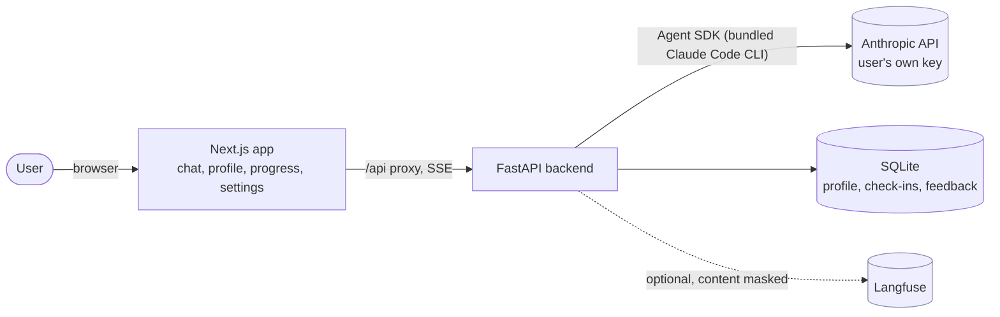
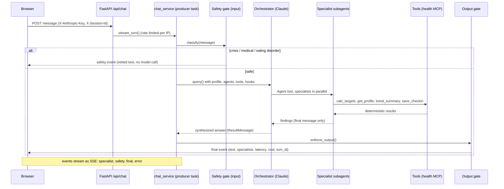
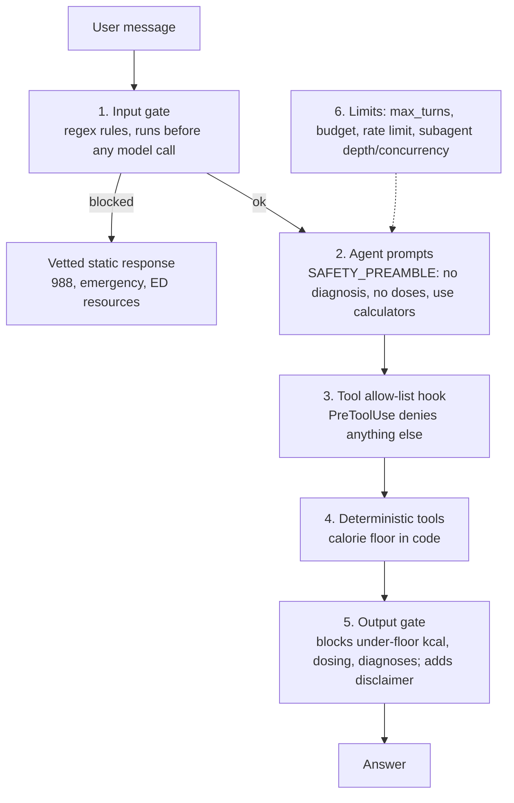
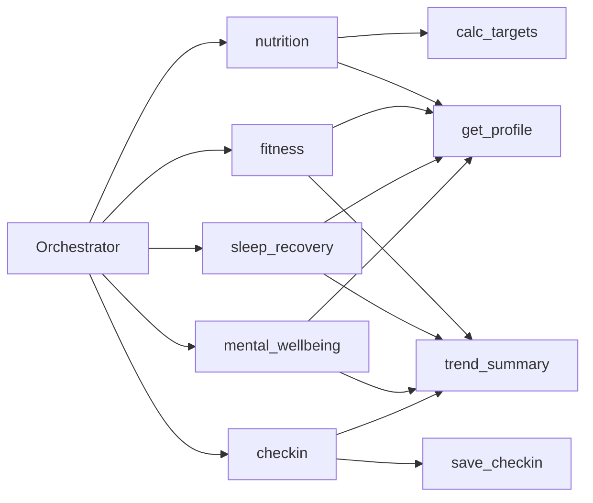
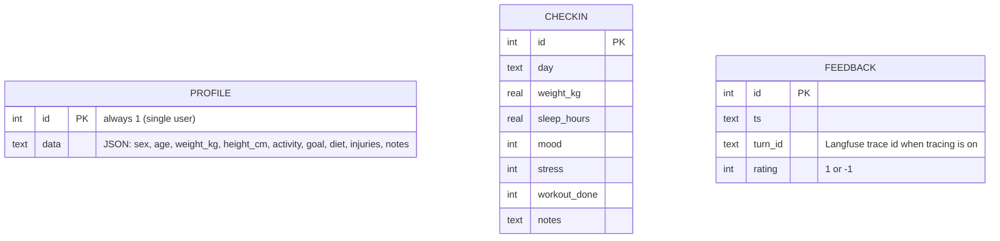

# Architecture

Status: describes what is implemented in this repo. Items marked *planned* are not built yet.

## 1. System context

The browser only talks to the Next.js origin; `next.config.ts` rewrites `/api/*` to FastAPI (`BACKEND_URL`).
Compression is off so the SSE chat stream is not buffered.

## 2. One chat turn

The whole turn, including the Langfuse trace, runs inside one producer task that feeds an `asyncio.Queue`; the HTTP
generator only reads the queue. This keeps OpenTelemetry context from being held across `yield`s.

## 3. Safety layers (defense in depth)

Details and known gaps: [safety.md](safety.md).

## 4. Components

| Component | Responsibility | Files |
|---|---|---|
| API | HTTP endpoints, SSE, request validation | `backend/app/main.py` |
| Chat service | Runs a turn inside a trace, queue to stream | `chat_service.py` |
| Orchestrator | Builds SDK options, maps messages to events | `orchestrator.py` |
| Specialists | `nutrition`, `fitness`, `sleep_recovery`, `mental_wellbeing`, `checkin` | `agents/definitions.py` |
| Tools | `calc_targets`, `get_profile`, `save_checkin`, `trend_summary` | `tools/` |
| Safety | rules, resources, gate, hooks | `safety/` |
| Memory | SQLite store | `memory/db.py` |
| Observability | Langfuse init, masking, scores | `observability.py` |
| Ops | JSON logs + request id, rate limit | `logging_setup.py`, `ratelimit.py` |
| Frontend | pages, SSE client, charts | `frontend/` |

### Models and limits
Orchestrator `claude-sonnet-5-5`; specialists `sonnet` (check-in uses `haiku`). Per turn: `max_turns=12`,
`max_budget_usd=1.0`, subagent depth 1, concurrency 4. Chat rate limit: `CHAT_RATE_LIMIT_PER_MIN` (default 20) per IP.

## 5. Specialists and tools

## 6. Data model

All data is local. `DELETE /api/data` wipes all three tables; `GET /api/export` dumps profile and check-ins.

## 7. API

| Method | Path | Purpose |
|---|---|---|
| GET | `/health`, `/ready` | liveness; readiness (DB check) |
| POST | `/api/chat` | SSE stream of turn events |
| POST | `/api/targets` | TDEE, safe calorie target, macros, BMI |
| GET, PUT | `/api/profile` | read / save profile |
| GET, POST | `/api/checkins` | list / add check-in |
| POST | `/api/feedback` | thumbs up/down (also a Langfuse score) |
| GET | `/api/export` | export profile and check-ins |
| DELETE | `/api/data` | delete everything |

SSE events: `{type: "specialist", name}`, `{type: "safety", text, category}`,
`{type: "final", text, specialists, latency_ms, cost_usd, turn_id, output_gate_blocked}`, `{type: "error", text}`.

## 8. Deployment

`docker-compose.yml`: `backend` (volume `/data`, not published) and `frontend` (port 3000, `BACKEND_URL` baked in at
build time because Next rewrites are resolved during `next build`). Single backend worker: the rate limiter and the
SQLite store are per-process. Images are written but have not been built in CI yet.

## 9. Decisions and trade-offs

- **Agent SDK over a hand-rolled loop:** subagents, tool hooks and budgets come built in; cost is a bundled CLI and
  less control over the loop. Tool and hook behavior with the real CLI is still unverified (see CLAUDE.md).
- **Rules before an LLM for safety:** deterministic, instant, free, testable, but low recall on indirect phrasing.
  *Planned:* a Haiku-class classifier as a second stage (see evals hard tier).
- **SQLite and a single worker:** right for a local demo; a hosted multi-user version needs auth, per-user storage,
  a shared rate limiter and stronger privacy controls.
- **BYO key, no accounts:** zero server-side secrets for users; shifts cost and responsibility to the user.
